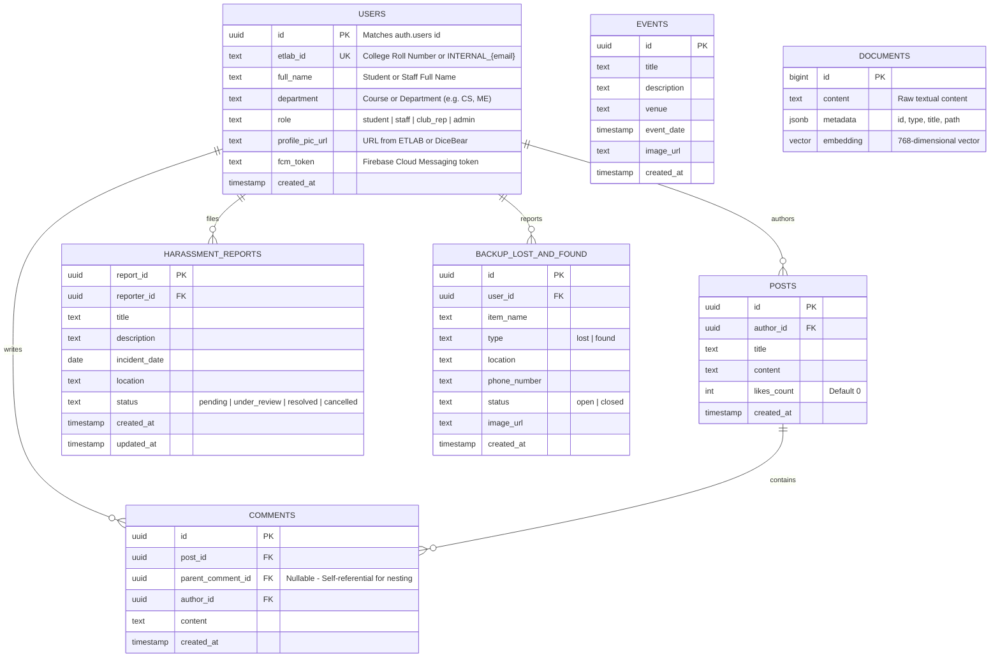

# Campus App: Comprehensive Project Documentation & Interview Guide

> **Document Type:** Production Architecture Reference & Engineering Study Guide  
> **Target Audience:** Technical Interviewers, LLM Ingestion, Software Engineers  
> **Repository:** `mini_project` (`campusapp` + `campus_backend`)  
> **Date:** November 2026  

---

## 1. Executive Summary

**Campus App** is an all-in-one smart mobile campus management and community ecosystem engineered for higher education institutions (originally customized and tested for **SCTCE — Sree Chitra Thirunal College of Engineering**). 

The platform bridges university administration, academic clubs, faculty, and students into a unified digital experience. It combines traditional university portal functions with modern community networking, grievance redressal, lost-and-found management, and an intelligent **Retrieval-Augmented Generation (RAG) AI Assistant** capable of deep-linking directly into application resources.

### High-Level Problem Statement
1. **Fragmented Campus Communication:** University notices, club events, and peer discussions are typically scattered across WhatsApp groups, physical notice boards, and disconnected portals.
2. **Outdated ERPs & Portals:** Systems like college ETLAB portals lack real-time mobile push notifications, modern UX, offline caching, and responsive student discussion feeds.
3. **Safety & Grievance Inefficiencies:** Grievance and anti-ragging reporting often suffer from lack of confidentiality, formal tracking, or verifiable audit trails.
4. **Information Silos:** Students struggle to quickly query campus schedules, rules, or event details without human assistance.

---

## 2. System Architecture & Tech Stack

The platform is designed around a decoupled client-server microservice-style architecture with cloud BaaS persistence and local on-device caching.

```
                           +----------------------------------------------+
                           |             Flutter Mobile Client            |
                           |  (Dart ^3.10.7, Material 3, Hive Offline DB) |
                           +----------------------------------------------+
                                         |                  |
                       Direct Client Calls|                  | RESTful API Requests
                     (Supabase Storage/Auth)                | (FastAPI Proxy / RAG)
                                         v                  v
                 +-------------------------------------------------------------+
                 |                       FastAPI Backend                       |
                 |               (Python 3.13, Async Uvicorn)                  |
                 +-------------------------------------------------------------+
                   |                 |                 |                     |
      ETLAB Web Scraping      Supabase DB      Groq Cloud LLM         Firebase Admin SDK
     (sctce.etlab.in Auth)    (PostgreSQL &    (Llama-3.3-70B JSON &  (Multicast Push
                              pgvector Embed)  Llama-3.1-8B Keywords)  Notifications)
```

### 2.1 Frontend Architecture (Flutter Client — `campusapp/`)
* **Framework:** Flutter SDK `^3.10.7` using Dart.
* **Design Language:** Modern Dark Theme using Material 3 specifications (`AppColors.background`, `AppColors.cardGrey`, `AppColors.accentBorder`).
* **State & Navigation Management:** StatefulWidgets with `GlobalKey` state handles for programmatic cross-screen invalidation, `IndexedStack` for persistent bottom-bar tab navigation, and animated navigation pill indicators (`CustomAiamtedNavBar`).
* **Offline Caching:** **Hive & Hive Flutter** (`hive: ^2.2.3`). Key-value boxes:
  * `events_cache`: Stores the first page of campus events for instant rendering on launch.
  * `posts_cache`: Caches recent community posts.
  * `chat_history`: Persists per-user multi-turn AI chatbot interactions locally.
* **UI & Performance Optimizations:**
  * **Shimmer Skeleton Loading:** `shimmer: ^3.0.0` for smooth skeleton loading states instead of plain spinners.
  * **Debounced Search:** Timer-based debouncing on search and filtering inputs to minimize unnecessary network calls.
  * **Lazy Loading / Infinite Scroll:** Scroll listener on events feed that triggers subsequent page fetches 200px before the user reaches the bottom.
* **Document Compilation:** `pdf: ^3.10.7` and `printing: ^5.11.1` for programmatic client-side PDF rendering and native print/export dialogs.
* **Network & Push:** `http: ^1.6.0`, `firebase_messaging: ^15.1.4`, `firebase_core: ^3.6.0`.
* **Markdown Rendering:** `flutter_markdown: ^0.7.7+1` for parsing rich text and structured AI responses in chat.

### 2.2 Backend Architecture (FastAPI Service — `campus_backend/`)
* **Framework:** FastAPI with Python 3.13 running on Uvicorn.
* **Modularity:** Split into dedicated API routers:
  * `main.py`: Core routing, ETLAB login proxy, user profile sync, event broadcasting, and AI chat pipeline.
  * `community.py`: Community posts, recursive comments, and like/unlike handlers.
  * `harassment.py`: Grievance submission, administrative incident monitoring, and anti-tamper cancellation.
  * `backup_lost_found.py`: Active lost-and-found registry, query/sort handlers, and case resolution.
  * `ai_utils.py`: Local vector embedding generation, zero-padding adapter, and Groq keyword extraction.
* **Web Scraping Reverse Proxy:** `requests.Session` with `BeautifulSoup4` simulating full browser headers to authenticate against legacy Yii-based university portals (`sctce.etlab.in`).
* **Database Drivers:** `supabase` Python client with dual connection support: standard public anon client and elevated `SUPABASE_SERVICE_ROLE_KEY` client for administrative actions.

### 2.3 Cloud Infrastructure, Database & Storage
* **Primary Database:** **Supabase PostgreSQL**.
* **Vector Store:** PostgreSQL with `pgvector` extension for vector embeddings inside the `documents` table.
* **Storage Buckets:** Supabase Object Storage:
  * `event_images`: Public bucket for event promotional banners.
  * `backup_lost_found_images`: Public bucket for lost/found item photo attachments.
* **Push Notifications:** Firebase Cloud Messaging (FCM) using Firebase Admin SDK on the backend and Firebase Messaging on mobile.

### 2.4 AI, LLM & RAG Pipeline
* **Inference LLM:** **Groq Cloud API** running `llama-3.3-70b-versatile` with forced JSON object schema (`response_format={"type": "json_object"}`).
* **Query Preprocessor LLM:** `llama-3.1-8b-instant` for near-instant semantic keyword and date extraction (e.g., converting "April 6th" into `04-06` format).
* **Local Embedding Engine:** `sentence-transformers/all-MiniLM-L6-v2` (running locally via PyTorch / HuggingFace Transformers, ~80MB footprint).
* **Zero-Padding Adapter:** Resolves vector dimensionality mismatch: the local MiniLM model outputs 384-dimensional vectors, which are zero-padded to 768 dimensions in NumPy to match the PostgreSQL 768-dimensional vector column schema.

---

## 3. Role-Based Access Control (RBAC) Matrix

The system enforces strict multi-tier role authorization across frontend tabs and backend endpoints:

| Feature / Action | Student (`student`) | Teacher / Staff (`staff`) | Club Representative (`club_rep`) | System Administrator (`admin`) |
| :--- | :---: | :---: | :---: | :---: |
| **Login via College Portal (ETLAB)** | Yes (Auto-Scraped) | No (Direct Auth) | No (Direct Auth) | No (Direct Auth) |
| **View Community Posts & Comments** | Yes | Yes | Yes | Yes |
| **Create Community Post / Comment** | Yes | Yes | Yes | Yes |
| **View Campus Events Feed** | Yes | Yes | Yes | Yes |
| **Create / Publish New Events** | No | No | **Yes** | **Yes** |
| **Report / View Lost & Found** | Yes | Yes | Yes | Yes |
| **Close Own Lost & Found Case** | Yes | Yes | Yes | Yes |
| **Submit Harassment / Grievance Report** | **Yes** (`MyReportsPage`) | No | No | No |
| **Cancel Harassment Report** | **Yes** (Only after 30 days) | No | No | No |
| **Monitor All Harassment Reports** | No | **Yes** (`HarassmentMonitorPage`) | No | **Yes** |
| **Update Grievance Status** | No | **Yes** | No | **Yes** |
| **Export Official Incident PDF** | No | **Yes** | No | **Yes** |
| **Access Admin User Creation Panel** | No | No | No | **Yes** (`AdminPanelPage`) |
| **Use Campus AI Assistant** | Yes | Yes | Yes | Yes |

---

## 4. In-Depth Feature Implementation

### 4.1 Hybrid Authentication & Portal Reverse-Proxy
* **Implementation File:** [`campus_backend/main.py`](file:///Users/adithyanmanoj/Codes_and_all/mini_project/campus_backend/main.py#L106-L326) & [`campusapp/lib/pages/login_page.dart`](file:///Users/adithyanmanoj/Codes_and_all/mini_project/campusapp/lib/pages/login_page.dart)
* **How It Works:**
  1. If the user logs in with an email containing `@`, the backend handles it directly via native Supabase Auth (`supabase1.auth.sign_in_with_password`).
  2. If the user provides a standard college roll number / student ID, the backend acts as a headless reverse-proxy:
     * Pre-visits `https://sctce.etlab.in/user/login` using `requests.Session()` to establish valid session cookies.
     * Submits a POST request mimicking a browser form submission with `LoginForm[username]`, `LoginForm[password]`, and `yt0`.
     * Upon receiving a 200 status and verifying redirect to the student dashboard/profile, it scrapes the student's **Full Name**, **Department/Course/Branch**, and **Profile Photo** using `BeautifulSoup`.
  3. **Auto-Provisioning & Password Sync:**
     * Maps the student to a virtual email: `<username>@sctce.ac.in`.
     * If the user is logging in for the first time, it provisions the user in Supabase Auth via `supabase1.auth.admin.create_user`.
     * If the user already exists in Auth but changed their college password, it catches the error and utilizes `supabase1.auth.admin.update_user_by_id` to force-sync the password.
  4. **Ghost ID Repair Migration:** If the internal Supabase UUID ever diverged from legacy data, the backend executes an automatic data repair migration across tables (`posts`, `comments`, `likes`, `harassment_reports`, `lost_and_found`), transferring foreign key ownership to the authenticated UUID before deleting orphaned records.
  5. **Session Injection:** The backend returns Supabase session tokens (`access_token`, `refresh_token`), which the Flutter client injects directly into `Supabase.instance.client.auth.setSession()`.

### 4.2 Community Networking Hub & Nested Discussion Trees
* **Implementation Files:** [`campus_backend/community.py`](file:///Users/adithyanmanoj/Codes_and_all/mini_project/campus_backend/community.py), [`campusapp/lib/pages/community_page.dart`](file:///Users/adithyanmanoj/Codes_and_all/mini_project/campusapp/lib/pages/community_page.dart), [`campusapp/lib/models/comment_model.dart`](file:///Users/adithyanmanoj/Codes_and_all/mini_project/campusapp/lib/models/comment_model.dart), [`campusapp/lib/pages/post_details.dart`](file:///Users/adithyanmanoj/Codes_and_all/mini_project/campusapp/lib/pages/post_details.dart)
* **How It Works:**
  * **Post Feed:** Fetches community posts sorted by `created_at DESC` joined with author profile metadata (`full_name`, `profile_pic_url`). Posts are cached locally in Hive for offline instant startup.
  * **Recursive Comment Tree Algorithm:**
    * The backend stores comments in a flat relational table with an optional `parent_comment_id` UUID column.
    * When retrieved by Flutter, [`CommentModel.buildTree()`](file:///Users/adithyanmanoj/Codes_and_all/mini_project/campusapp/lib/models/comment_model.dart#L40-L51) performs an $O(n)$ hash-map assembly:
      ```dart
      static List<CommentModel> buildTree(List<CommentModel> flat) {
        final map = <String, CommentModel>{for (var c in flat) c.id: c};
        final roots = <CommentModel>[];
        for (final comment in flat) {
          if (comment.parentId == null) {
            roots.add(comment);
          } else {
            map[comment.parentId]?.subComments.add(comment);
          }
        }
        return roots;
      }
      ```
    * The UI displays parent comments with indented threaded replies, including a "Replying to @username" banner and cancelable reply focus states.
  * **Upvotes / Likes:** Atomic backend counter increment/decrement (`likes_count`).
  * **Real-time AI Ingestion:** As soon as a user publishes a post via `create_post`, the backend triggers `upsert_document()` to vectorize the content and index it into the AI knowledge base.

### 4.3 Events Discovery & Management
* **Implementation Files:** [`campus_backend/main.py`](file:///Users/adithyanmanoj/Codes_and_all/mini_project/campus_backend/main.py#L380-L448), [`campusapp/lib/pages/events_page.dart`](file:///Users/adithyanmanoj/Codes_and_all/mini_project/campusapp/lib/pages/events_page.dart), [`campusapp/lib/pages/create_event_page.dart`](file:///Users/adithyanmanoj/Codes_and_all/mini_project/campusapp/lib/pages/create_event_page.dart)
* **How It Works:**
  * **Paginated API:** `GET /events?page={page}&limit=5&date={date}&search={search}`.
  * **Frontend Caching & Infinite Scroll:** First page is cached in Hive. When the user scrolls within 200px of the list boundary, `_scrollListener` requests the next page. A local map (`_paginationCache`) avoids redundant network roundtrips when navigating between filters.
  * **Restricted Creation:** Only users with `admin` or `club_rep` roles see the Event Creation Floating Action Button.
  * **Media Upload:** Event poster images are uploaded from the device gallery via `image_picker` directly into Supabase Storage bucket `event_images`.
  * **Push Notification Broadcast:** Upon successful event creation, the backend queries all active `fcm_token` values in the `users` table and executes a Firebase Cloud Messaging multicast broadcast (`messaging.send_multicast`).
  * **AI Ingestion:** Automatically embeds event title, venue, date, and description into the vector store.

### 4.4 Lost and Found Management Module
* **Implementation Files:** [`campus_backend/backup_lost_found.py`](file:///Users/adithyanmanoj/Codes_and_all/mini_project/campus_backend/backup_lost_found.py), [`campusapp/lib/pages/backup_lost_found/`](file:///Users/adithyanmanoj/Codes_and_all/mini_project/campusapp/lib/pages/backup_lost_found/)
* **How It Works:**
  * **Status Categorization:** Dedicated tab controller dividing items into `Lost` (open), `Found` (open), and `Closed` (resolved cases).
  * **Item Reporting:** Form supporting item name, category, location found/lost, contact phone number, reporter UUID, and optional photo upload to Supabase Storage bucket `backup_lost_found_images`.
  * **Search & Sort:** Case-insensitive search on item titles (`ilike '%query%'`) combined with sorting either by newest creation date or alphabetical name order.
  * **Case Resolution:** Item creators can close their cases via `PATCH /backup-lost-found/{item_id}/close`, which updates status to `closed` and moves the card to the resolved tab.

### 4.5 Campus Care: Harassment & Grievance Redressal System
* **Implementation Files:** [`campus_backend/harassment.py`](file:///Users/adithyanmanoj/Codes_and_all/mini_project/campus_backend/harassment.py), [`campusapp/lib/pages/harassment/`](file:///Users/adithyanmanoj/Codes_and_all/mini_project/campusapp/lib/pages/harassment/), [`campusapp/lib/services/pdf_service.dart`](file:///Users/adithyanmanoj/Codes_and_all/mini_project/campusapp/lib/services/pdf_service.dart)
* **How It Works:**
  * **Confidential Reporting (`ReportFormPage`):** Students file structured incident reports with Title, Narrative Description, Incident Date & Time picker, and Campus Location.
  * **Status Lifecycle:** `pending` $\rightarrow$ `under_review` $\rightarrow$ `resolved` or `cancelled`.
  * **Anti-Tampering & Coercion Safeguard:** To prevent ragging or harassment victims from being immediately pressured or coerced into withdrawing their complaints, the backend enforces a mandatory 30-day lock:
    ```python
    if (datetime.now(timezone.utc) - created_at) <= timedelta(days=30):
        raise HTTPException(
            status_code=400, 
            detail="Cannot manually cancel a report until 1 month has passed"
        )
    ```
  * **Staff Incident Monitor (`HarassmentMonitorPage`):** Faculty members and anti-ragging committee members review all submitted campus reports, filter by status chips, and update incident statuses in real time.
  * **Official Incident PDF Generation (`PdfService`):** Staff can click an "Export to PDF" button on any incident detail page. The service programmatically draws an official A4 document featuring:
    * Official reference number (`#REF-ID` generated from UUID).
    * Status badge with color coding (Orange for pending, Blue for under review, Green for resolved).
    * Reporter profile data (Name, Department, ID, submission timestamp).
    * Formal incident narrative and legal disclaimer ("Generated by Campus Care App - Unauthorized sharing prohibited").
    * Opens directly into native iOS/Android print and PDF save sheets.

### 4.6 Campus AI Assistant (RAG Pipeline with Deep Linking)
* **Implementation Files:** [`campus_backend/ai_utils.py`](file:///Users/adithyanmanoj/Codes_and_all/mini_project/campus_backend/ai_utils.py), [`campus_backend/main.py`](file:///Users/adithyanmanoj/Codes_and_all/mini_project/campus_backend/main.py#L497-L576), [`campusapp/lib/pages/ai_chat_page.dart`](file:///Users/adithyanmanoj/Codes_and_all/mini_project/campusapp/lib/pages/ai_chat_page.dart)
* **How It Works:**
  1. **Knowledge Ingestion (`upsert_document`):** 
     * Takes text content + metadata (`type: event|post|appinfo`, `id`, `title`, `path`).
     * Encodes text using the local `all-MiniLM-L6-v2` SentenceTransformer into a 384-dimensional vector.
     * Padds the vector with zeros up to 768 dimensions using NumPy:
       ```python
       padded_embedding = np.zeros(768)
       padded_embedding[:len(embedding)] = embedding
       ```
     * Stores content, metadata, and embedding into the Supabase `documents` table.
  2. **Query Processing & Retrieval:**
     * A student asks: *"Is there any coding event happening on April 6th?"*
     * The backend queries Groq (`llama-3.1-8b-instant`) with a lightweight prompt instructed to extract the core keyword and convert spoken dates into `MM-DD` format (e.g. `04-06`).
     * Executes context retrieval against the `documents` table using the formatted keyword, returning relevant chunks and metadata.
  3. **LLM Generation with Strict JSON Enforcement:**
     * Sends context chunks + conversation history + student query to Groq (`llama-3.3-70b-versatile`) with `response_format={"type": "json_object"}`.
     * System instructions enforce the response structure:
       ```json
       {
         "answer": "Yes! The CodereCET Hackathon is scheduled for April 6th at CET Trivandrum...",
         "links": [
           { "type": "event", "id": "9b1deb4d-3b7d-4bad-9bdd-2b0d7b3dcb6d", "title": "CodereCET Hackathon" }
         ]
       }
       ```
  4. **Interactive Deep Linking in Flutter:**
     * `AiChatPage` parses the `links` array from the JSON response.
     * Renders `ActionChip` widgets directly below the chat bubble.
     * Tapping an ActionChip triggers `ApiService.fetchEventById(id)` or `ApiService.fetchPostById(id)` and immediately navigates to `EventDetailsPage` or `PostDetailPage`.
  5. **Session Memory:** All chat history is saved per-user in Hive box `chat_history`, providing continuous multi-turn dialogue across app restarts.

---

## 5. Database Schema & Data Models

### 5.1 Relational Tables in Supabase (PostgreSQL)



---

## 6. What Is Planned vs. What Is Implemented

To provide absolute accuracy during technical interviews and assessments, the following breakdown separates what is currently operational in the repository from what remains on the planned roadmap.

### 6.1 Currently Implemented & Verified
- [x] Full mobile-to-portal reverse-proxy authentication against university ETLAB (cookie session preservation, credential scraping, and BeautifulSoup HTML parsing).
- [x] Automated Supabase Auth provisioning and credential synchronization for scraped users.
- [x] Multi-tier Role-Based Access Control (`student`, `staff`, `club_rep`, `admin`) with dynamic UI reconfiguration.
- [x] Full community forum with post creation and infinite threaded/nested comments via $O(n)$ hash-map assembly.
- [x] Events feed with pagination (5 items/page), debounced keyword search, date filtering, and local pagination cache.
- [x] Offline-first architecture powered by Hive (local caching of events, posts, and AI chat history).
- [x] Full Lost and Found registry with image uploads, status filters (Lost / Found / Closed), and case resolution.
- [x] Confidential Harassment / Anti-Ragging reporting with mandatory 30-day anti-coercion cancellation safeguard.
- [x] Administrative Staff Incident Monitor with status management.
- [x] Native client-side PDF incident report generation and export dialog.
- [x] Campus AI chatbot with RAG pipeline, local SentenceTransformers embedding generation, Groq LLM inference, and interactive deep-linking ActionChips.
- [x] Push notification multicast broadcast for new events via Firebase Admin SDK.
- [x] Admin panel for provisioning staff and club representative accounts.

### 6.2 In Progress & Planned Roadmap

```
+--------------------------------------------------------------------------------+
|                                 ROADMAP PHASES                                 |
+--------------------------------------------------------------------------------+
|  PHASE 1: Immediate Enhancements (WIP in Current Codebase)                     |
|  - In-App Event RSVP & Ticket Reservation System (button exists in UI)         |
|  - Community Feed Text Search (search icon in AppBar to be connected)         |
|  - Comprehensive Lost & Found AI Ingestion (indexing lost items into RAG)      |
|  - Personalized Push Notifications (comment replies, status change alerts)     |
+--------------------------------------------------------------------------------+
|  PHASE 2: Architectural & Real-Time Upgrades                                  |
|  - WebSockets / Supabase Realtime for instant comments, likes, and chat       |
|  - Native pgvector Cosine RPC function in PostgreSQL for hybrid search         |
|  - Transition from ETLAB scraping to official University OAuth 2.0 / SSO       |
+--------------------------------------------------------------------------------+
|  PHASE 3: Academic & Community Expansions                                      |
|  - Academic Hub / Study Page (lecture notes, PYQs, timetable integration)      |
|  - Multi-image attachments & PDF file uploads for community posts              |
|  - AI Content Moderation & Toxicity Filter for community posts/comments        |
|  - Anonymous Whistleblower Mode for zero-knowledge harassment reporting        |
|  - Web-based Analytics Dashboard for college administration                   |
+--------------------------------------------------------------------------------+
```

#### Detailed Breakdown of Roadmap Items:

1. **In-App Event RSVP & Ticket Reservation:**
   * *Current State:* The `EventDetailsPage` features a styled "Register" button, but its `onPressed` callback is currently a placeholder (`// Logic for registration (e.g., Launch URL)`).
   * *Plan:* Connect the button to an event registration table, generating a digital QR code pass with seat limits and attendance validation.
2. **Personalized Notifications Subsystem:**
   * *Current State:* Event announcements broadcast to all registered devices.
   * *Plan:* Targeted notifications when another user replies to your comment, when someone likes your post, or when a staff member updates the status of your harassment report from `pending` to `under_review` or `resolved`.
3. **Lost & Found Knowledge Base Ingestion:**
   * *Current State:* Events and community posts are automatically vectorized and indexed into the `documents` table upon creation. Lost & Found items are currently stored only in the relational table.
   * *Plan:* Automatically embed Lost & Found items so students can ask the AI: *"Has anyone found a set of bike keys near the cafeteria?"* and receive deep-linked item cards.
4. **Native PostgreSQL Cosine Distance Search:**
   * *Current State:* Uses Groq-powered keyword extraction followed by SQL `ilike` matching against the vector store documents.
   * *Plan:* Deploy a PostgreSQL database function `match_documents(query_embedding, match_threshold, match_count)` utilizing the native pgvector `<=>` cosine distance operator for pure semantic hybrid retrieval.
5. **Academic Hub (`StudyPage` Expansion):**
   * *Current State:* `study_page.dart` exists in the repository as a basic prototype list.
   * *Plan:* Develop a complete academic resource repository where students can download syllabus modules, access previous year question papers (PYQs), share study notes, and track examination schedules.
6. **AI Toxicity & Content Moderation Filter:**
   * *Plan:* Deploy a lightweight pre-moderation pipeline on the FastAPI backend (using a toxicity classification model or Groq guardrail) to flag or block hate speech, abusive language, or doxxing before community posts or comments are stored in the database.
7. **Anonymous Whistleblower Protection:**
   * *Plan:* Provide a toggle in `ReportFormPage` allowing students to submit sensitive reports completely anonymously (without recording `reporter_id`), while enabling an encrypted one-way chat channel with the college anti-ragging squad.

---

## 7. Technical Interview Preparation & Talking Points

Use these questions and model answers to master interview discussions regarding the architecture and implementation of this project.

### Q1: Why did you choose FastAPI over Flask or Django for this backend?
> **Answer:**  
> "I chose FastAPI primarily for three reasons:
> 1. **Native Asynchronous Concurrency:** FastAPI is built on top of Starlette and ASGI, which allows us to handle high-concurrency I/O operations (like proxying requests to ETLAB, querying Supabase, and calling Groq LLM APIs) asynchronously without blocking the event loop.
> 2. **Pydantic Data Validation:** FastAPI offers automatic request payload validation and serialization through Pydantic models (such as `EventCreate`, `LostFoundItem`, `ChatRequest`), which catches malformed requests before they hit database queries.
> 3. **AI/ML Ecosystem Compatibility:** The backend integrates local PyTorch and HuggingFace models (`sentence-transformers`) alongside async client calls to Groq. Python is the native ecosystem for these tools, and FastAPI provides low latency for serving ML inference."

### Q2: How did you implement authentication with the college ETLAB portal when no official API existed?
> **Answer:**  
> "Because the legacy college portal (`sctce.etlab.in`) lacked a public REST API or OAuth endpoints, I built a secure reverse-proxy authentication bridge:
> 1. When a student enters their roll number and password, our FastAPI backend creates an isolated `requests.Session`.
> 2. It performs a preliminary handshake with the portal to acquire required session cookies.
> 3. It then submits an authentic HTTP POST payload matching the Yii-framework login structure (`LoginForm[username]`, `LoginForm[password]`, `yt0`).
> 4. Upon detecting a successful redirect to the student dashboard, it uses `BeautifulSoup` to parse student metadata (Full Name, Branch/Department, and Profile Photo).
> 5. Finally, the backend transparently provisions or syncs an authenticated Supabase user account (`<username>@sctce.ac.in`) using the Supabase Service Role Key and returns standard JWT tokens to the Flutter app. This ensures our app maintains modern token-based authentication while retaining the college's existing credentials as the single source of truth."

### Q3: Explain how your RAG (Retrieval-Augmented Generation) pipeline works and why you used zero-padding on embeddings.
> **Answer:**  
> "The RAG pipeline enables our AI Assistant to answer questions about campus activities accurately without hallucinating:
> 1. **Ingestion:** Whenever a new event or post is created, its textual content and metadata (ID, type, title, deep-link route) are processed.
> 2. **Embedding & Zero-Padding:** We use a local `all-MiniLM-L6-v2` SentenceTransformer to generate embeddings locally on the server for speed, privacy, and zero API costs. However, MiniLM produces 384-dimensional vectors, while our Supabase PostgreSQL `documents` table was provisioned with a 768-dimensional vector column (standard for models like Google Gecko / BERT). Rather than migrating the production schema or paying for external embedding APIs, I wrote an adapter using NumPy that zero-pads the 384-dim vector to 768 dimensions. This preserved database compatibility without degrading keyword and semantic lookups.
> 3. **Retrieval & Query Parsing:** We use Groq (`llama-3.1-8b-instant`) to extract the exact keywords and format dates (e.g., turning 'April 6th' into '04-06') from user queries, then retrieve relevant document chunks from PostgreSQL.
> 4. **Structured Generation:** Groq (`llama-3.3-70b-versatile`) generates the final answer in forced JSON mode. The JSON contains the conversational response and an array of metadata IDs, which the Flutter client parses to render interactive ActionChips that allow users to jump directly to the relevant event or post details page."

### Q4: How is the nested/threaded comment structure handled between the database and Flutter?
> **Answer:**  
> "In relational databases, querying deeply nested recursive structures via SQL joins can be expensive and prone to $N+1$ query issues.  
> To optimize this:
> 1. Our Supabase `comments` table stores comments as a flat list with a self-referencing foreign key: `parent_comment_id` (which is `NULL` for top-level comments and a UUID for replies).
> 2. The backend returns a flat list ordered by `created_at ASC` in a single query.
> 3. On the Flutter client, we run an $O(n)$ tree-construction algorithm (`CommentModel.buildTree`). We build an in-memory hash map of all comments by their ID, iterate through the list once, and append any comment with a `parentId` to its parent's `subComments` list. Top-level comments are collected as root nodes.
> 4. This offloads tree reconstruction to the client device, keeping the backend endpoint fast, stateless, and lightweight."

### Q5: How did you design the offline caching strategy in Flutter?
> **Answer:**  
> "We implemented an offline-first cache strategy using **Hive**, a lightweight, high-performance NoSQL key-value database written in pure Dart:
> 1. We initialized dedicated boxes: `events_cache`, `posts_cache`, and `chat_history`.
> 2. When the user opens the app, the UI immediately loads and renders the cached JSON objects from Hive, allowing instant screen rendering without waiting for network latency.
> 3. In the background, the app fires network requests to FastAPI/Supabase. Once fresh data arrives, it updates the screen seamlessly and overwrites the cache for subsequent launches.
> 4. For the AI assistant, storing message history in Hive allows multi-turn conversations to persist across app sessions even when the device goes offline."

### Q6: What is the rationale behind the 30-day anti-cancellation lock in the harassment module?
> **Answer:**  
> "Campus harassment and ragging reports have unique socio-psychological dynamics: victims are frequently subjected to immediate peer pressure, coercion, or intimidation to withdraw their complaints right after filing.  
> To address this:
> - The backend enforces a business rule: students can file reports at any time, but they cannot manually cancel a submitted report until 30 days have elapsed (`datetime.now() - created_at > timedelta(days=30)`).
> - Staff and anti-ragging authorities retain full authority to review, update, or dismiss reports through the `HarassmentMonitorPage`. This prevents bad actors from forcing a victim to delete a report before the administration can document and investigate the incident."

---

## 8. File & Directory Reference

```
mini_project/
├── campus_backend/                 # FastAPI Python Backend
│   ├── main.py                     # Entry point, ETLAB reverse-proxy, Auth sync, Events, AI chat
│   ├── community.py                # Community posts, recursive comments, likes router
│   ├── harassment.py               # Grievance reports & 30-day anti-tamper logic
│   ├── backup_lost_found.py        # Lost & Found API routes and case resolution
│   ├── ai_utils.py                 # SentenceTransformer local embeddings & vector zero-padding
│   ├── seed_app_info.py            # AI knowledge base seeding for system capabilities
│   ├── seed_ai.py                  # Script to index existing events & posts into AI vector store
│   ├── sync_data.py                # Utility to resync DB items to AI vector store
│   ├── reindex_db.py               # Re-embeddings batch update script
│   ├── diagnose_rag.py             # Diagnostic test script for RAG retrieval verification
│   ├── requirements.txt            # Python dependencies (fastapi, uvicorn, groq, supabase, etc.)
│   └── models/all-MiniLM-L6-v2/    # Local offline SentenceTransformer model weights (~80MB)
│
├── campusapp/                      # Flutter Cross-Platform Client
│   ├── pubspec.yaml                # Flutter dependencies (hive, supabase_flutter, pdf, printing, etc.)
│   ├── lib/
│   │   ├── main.dart               # App entrypoint, Hive/Firebase/Supabase initialization
│   │   ├── core/
│   │   │   ├── api_config.dart     # Dynamic backend URL configuration (IP / port / env)
│   │   │   └── app_colors.dart     # Material 3 dark color palette tokens
│   │   ├── models/
│   │   │   ├── post_model.dart     # Community post model with JSON serialization
│   │   │   ├── comment_model.dart  # Recursive tree building comment model
│   │   │   ├── event_model.dart    # Campus event model
│   │   │   ├── harassment_report.dart # Incident grievance model with staff join fields
│   │   │   └── backup_lost_found_item.dart # Lost & Found data model
│   │   ├── services/
│   │   │   ├── api_service.dart    # Main API client (Auth, Events, Posts, Comments, FCM)
│   │   │   ├── ai_api_service.dart # HTTP client for AI chatbot endpoint
│   │   │   ├── harassment_service.dart # Client service for grievance endpoints
│   │   │   ├── backup_api_service.dart # Client service for Lost & Found endpoints
│   │   │   ├── cache_service.dart  # Hive NoSQL caching abstraction layer
│   │   │   └── pdf_service.dart    # PDF document compilation and printing engine
│   │   ├── widgets/
│   │   │   ├── custom_nav_bar.dart # Animated pill navigation bottom bar
│   │   │   ├── event_card.dart     # Event presentation card
│   │   │   ├── post_cards.dart     # Community feed post card with author metadata
│   │   │   ├── custom_button.dart  # Standardized interactive button
│   │   │   └── custom_text_field.dart # Form input field component
│   │   └── pages/
│   │       ├── splashScreen.dart   # Splash screen with auto-login session check
│   │       ├── login_page.dart     # Dual student/staff login interface
│   │       ├── dashboard.dart      # Root dashboard with RBAC tab configuration & AI FAB
│   │       ├── community_page.dart # Community feed with offline cache loading
│   │       ├── create_post.dart    # New post submission form
│   │       ├── post_details.dart   # Post details with threaded comment rendering
│   │       ├── events_page.dart    # Paginated events feed with debounced search/filters
│   │       ├── create_event_page.dart # Event creation form with image picker
│   │       ├── event_details_page.dart # Event hero details and registration button
│   │       ├── ai_chat_page.dart   # AI chat interface with ActionChip deep-linking
│   │       ├── profile_page.dart   # Student profile view and logout logic
│   │       ├── admin_panel_page.dart # Admin user provisioning interface
│   │       ├── harassment/
│   │       │   ├── report_form_page.dart          # Incident filing form with date/time picker
│   │       │   ├── my_reports_page.dart           # Student active reports tracking
│   │       │   ├── report_detail_page.dart        # Student report details & 30-day cancel button
│   │       │   ├── harassment_monitor_page.dart   # Staff all-incident monitoring panel
│   │       │   └── staff_report_detail_page.dart  # Staff status updater & PDF exporter
│   │       └── backup_lost_found/
│   │           ├── backup_lost_found_list_page.dart # Lost/Found categorized tabs & search
│   │           ├── backup_post_item_page.dart       # Item reporting form with image upload
│   │           └── backup_item_detail_page.dart     # Item details & case closure button

